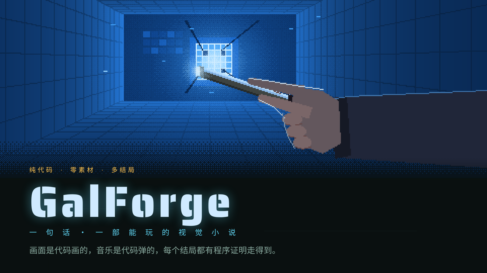
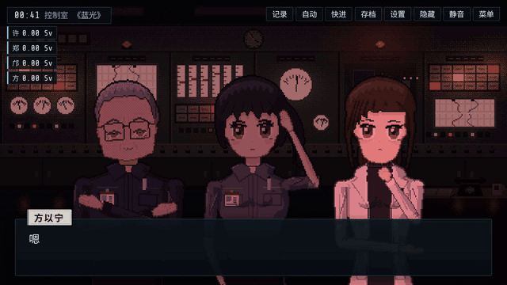
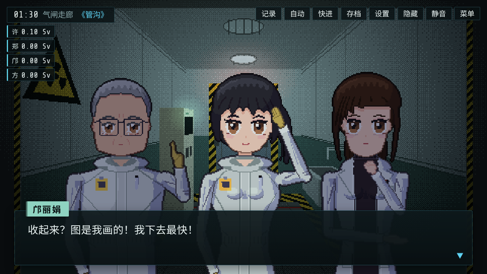
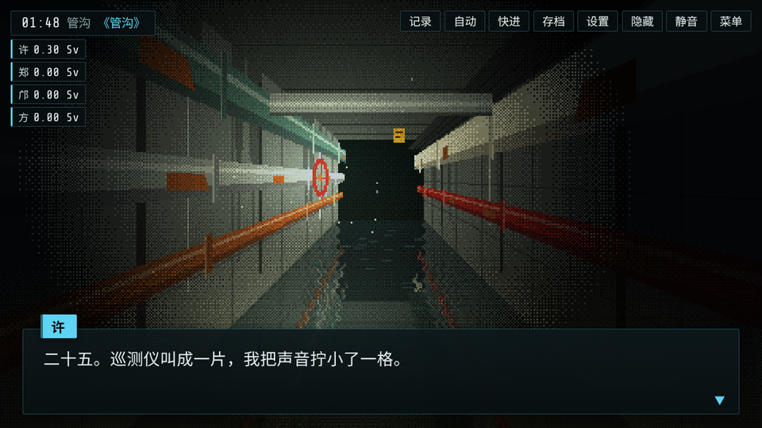
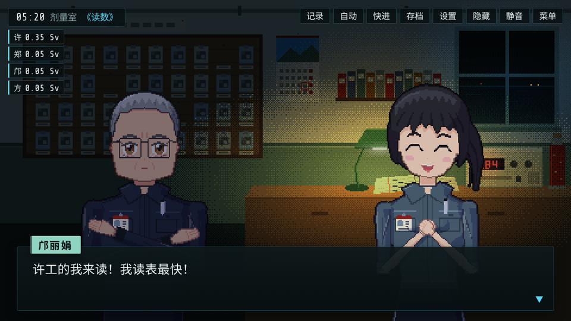
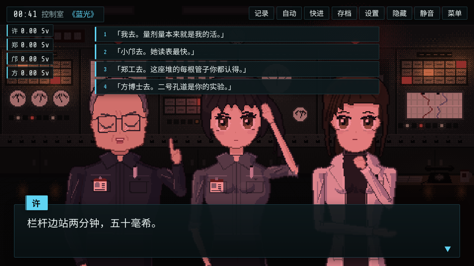
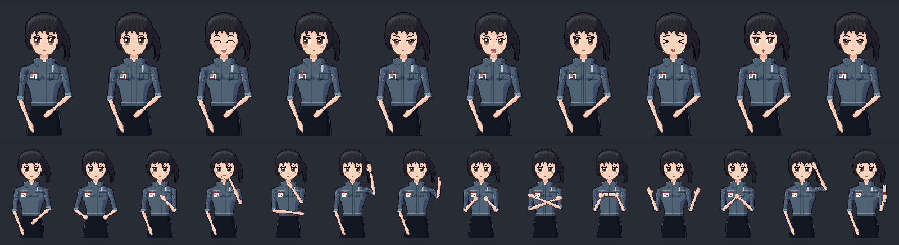
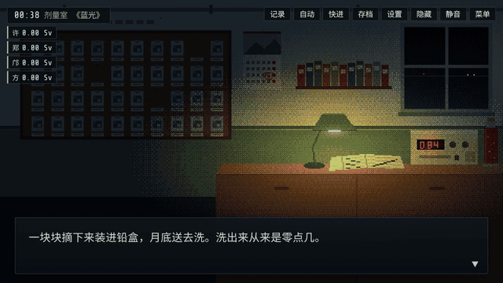

<p align="center">
  
</p>

<p align="center">
  <b>一句话进去，一部能玩的像素视觉小说出来。</b><br>
  立绘、场景、配乐都是代码现写的：不用一张图片素材，也不调生图模型。
</p>

<p align="center">
  <a href="https://lyra-planet.github.io/galforge/"></a>
  <a href="LICENSE"></a>
  <a href="https://agentskills.io/"></a>
  <a href="#安装"></a>
  <a href="#安装"></a>
  <a href="#安装"></a>
  <a href="#安装"></a>
  <a href="#安装"></a>
  <a href="#安装"></a>
</p>

<p align="center">
  <a href="https://lyra-planet.github.io/galforge/"><b>在线试玩</b></a> ·
  <a href="#一句话做出来的游戏">看成品</a> ·
  <a href="#安装">安装</a> ·
  <a href="#它是怎么做的">它是怎么做的</a> ·
  <a href="README_EN.md">English</a>
</p>

## 一句话做出来的游戏

> 「写一个辐射主题的」

给 agent 的要求就这么一句。它交回来的是《余量》：

九十年代，一座海边研究所的研究堆出事的那一夜。你是值夜班的剂量员，手里有一本账，记着每个人今晚还能吃多少辐射。每件要进高剂量区的事都得有人去，去的人花掉的是自己的余量。天亮以前，你要把每个人的数写进登记簿，报给所长。

<p align="center">
  <a href="https://lyra-planet.github.io/galforge/"></a>
</p>

<p align="center">
  <b>4 章 · 6 个结局 · 25 个选择点 · 1064 句台词 · 3 张 CG · 5 首配乐 · 一周目 40–50 分钟</b><br>
  <a href="https://lyra-planet.github.io/galforge/">▶ 在浏览器里直接玩</a>
</p>

<p align="center">
  
  
  
  
</p>

整部游戏（引擎、美术、配乐、剧本）一共 454 KB，比上面那段动图还小。

## 每个像素都是代码

<p align="center">
  
</p>

同一个角色的 10 种表情和 14 种姿势。发型、五官、衣服、手怎么摆，全是参数，改几个数就是另一个人；同一个人在一百个镜头里长一个样，换件衣服、加副眼镜也只是改一行代码。站在场景里时，她会眨眼、会呼吸，说话时嘴会动。

<p align="center">
  
</p>

灯光、天气、震屏、转场也是引擎现算的。上面这一下，广播报二级水位，屋里的光从台灯的暖黄变成警报红。配乐和环境音用 WebAudio 在浏览器里现场合成：《余量》有一首曲子是七拍一循环，盖革计数器的咔嗒声也是合成出来的。

## 写完先让程序把每条路走一遍

多结局游戏最怕两件事：某个结局谁也走不到，某条路走进死胡同。所以 skill 自带一套工具，交付前必须全过。这是《余量》交付前的一次结局求解：

```console
$ node tools/solve.js --endings
✓ E1《满水》  到达时 me=6 zheng=0 kuang=3 fang=2
✓ E2《余量》  到达时 me=10 zheng=0 kuang=0 fang=2
✓ E3《记录》  到达时 me=8 zheng=13 kuang=2 fang=1
✓ E4《改写》  到达时 me=1 zheng=1 kuang=4 fang=3
✓ E5《空池》  到达时 me=1 zheng=1 kuang=2 fang=1
✓ E6《交班》  到达时 me=1 zheng=1 kuang=4 fang=3
✓ 没有死路：每个到达的状态都至少有一个选项或出口

搜索了 2617676 个状态
```

| 交付前查了什么 | 《余量》的读数 |
|---|---|
| 剧本校验 | 0 个错误 |
| 结局求解 | 6 个结局都走得到，搜了 262 万个状态，没有死路 |
| 随机游玩 4 万局 | 6 个结局都会被随机玩家撞到，最少的一个占 2.3% |
| 引擎实跑 | 0 卡死、0 崩溃；96 个节点全部跑到；按最短选法把 6 个结局在引擎里各实跑一遍 |
| 独立审读 | 四章各派一个审读 agent，抓出 23 处严重、71 处一般问题，全部改完 |
| 真浏览器通关 | 桌面和手机宽度都通关；25 个按钮，没有一个小于 44 像素 |

<details>
<summary><b>十个工具</b></summary>

| 工具 | 做什么 |
|---|---|
| `validate.js` | 剧本校验：结构、引用、可达性、flag 读写配对、限时、文字标记、节奏、套路 |
| `solve.js` | 整局搜索：每个结局能不能走到、最短路径、数值范围、门槛概率、汇合点、随机走、死路 |
| `playtest.js` | 假 DOM 跑引擎：随机游玩、卡死崩溃、结局分布；按 solve 的路线把每个结局实跑一遍 |
| `browser_play.py` | 真浏览器自动通关、截图、触控尺寸审计（playwright） |
| `render_png.js` | 美术渲染成 PNG：角色 × 表情、姿势、场景 × 时段、同屏 |
| `dump_story.js` | 剧本压成紧凑文本，给审读用 |
| `fingerprint.js` | 和你以前做过的游戏比结构指纹，撞了提醒 |
| `audio_smoke.js` | 配乐冒烟测试 |
| `extract_lines.js` / `tts_batch.py` | 抽台词、批量配音（接任意命令行 TTS） |

</details>

## 每一部都不一样

语言模型每一步都挑最可能的选项，所以 AI 写的故事容易撞脸：倒计时当钩子，夕阳天台告白，机器人最后学会了感情。这个 skill 专门对付这件事：

- 文档里不给剧情、人物、台词的样例，格式示范只用占位符
- 构思时从 6 个不同的起点各长出一个候选，写完才对照一份套路清单，命中的要说出非用不可的理由
- 每部游戏记一行指纹（结构、人物、画面、声音……），下一部开工前比一遍，撞了就换

## 它是怎么做的


- 引擎（`assets/starter/`）是纯 HTML + JS，不用框架、不用构建，浏览器直接打开就能玩。有数值、flag、线索、分支、限时选择、存读档、快进、自动播放、回想、设置页
- 剧本是数据，引擎只负责读：主 agent 先立规范、写出第一章当示范，再把其余章节分给子 agent 同时写
- 流程和规范在 `SKILL.md` 和 `references/`，agent 按需读

## 安装

```bash
npx skills add lyra-planet/galforge
```

装的时候选你用的 agent。也可以直接 clone 到 agent 的 skill 目录：

```bash
# Claude Code
git clone https://github.com/lyra-planet/galforge ~/.claude/skills/galforge

# Codex、Cursor、Gemini CLI、OpenCode、GitHub Copilot 等
git clone https://github.com/lyra-planet/galforge ~/.agents/skills/galforge
```

只给某个项目用，就放进项目里的 `.claude/skills/` 或 `.agents/skills/`。

- 需要 node 18 以上，工具都是 node 脚本
- 真浏览器测试要 Python 版 playwright：`pip install playwright && playwright install chromium`
- 配音可选，接任意命令行 TTS

## 用法

装好以后，跟 agent 说想要什么就行：

- 「做个 galgame」
- 「做一部悬疑视觉小说，三个结局，四十分钟左右」
- 「写一个辐射主题的」

开工前它会把要问的一次问完：题材、角色年龄和内容提示、画风、配不配音、做完放哪。然后从构思一路做到能玩，交回一个文件夹，浏览器打开里面的 `index.html` 就能玩。

## 常见问题

<details>
<summary><b>我不会画画、不会作曲，能用吗？</b></summary>

能。画面和音乐都是 agent 写代码生成的，你只要说想要什么。不满意就直接说哪里丑，它会对着参考改。

</details>

<details>
<summary><b>只能做恋爱游戏吗？</b></summary>

不是。恋爱、悬疑、循环、日常、冒险都行；结构可以是共通线分个人线、单线多结局、线索推理、时间循环。《余量》就没有恋爱线。

</details>

<details>
<summary><b>做出来的游戏能发布吗？</b></summary>

游戏是一个纯静态文件夹，放到 GitHub Pages 或任意静态网站上就能玩。itch.io 直接传 zip；上 Steam 要用 NW.js 或 Electron 套成桌面程序。标题页会写明剧本由 AI 生成，Steam 和国内平台都要求这一条。

</details>

<details>
<summary><b>做出来的游戏能商用吗？</b></summary>

能。GalForge 是 MIT 许可。引擎文件开头带着一行许可声明，skill 把引擎拷进你的游戏时这行跟着走，不用另外做什么。

</details>

<details>
<summary><b>手机能玩吗？</b></summary>

能。竖屏会自动换布局，能点的东西至少 44 像素高。

</details>

<details>
<summary><b>能配音吗？</b></summary>

能。`tts_batch.py` 接任意命令行 TTS，批量合成，改了台词只重配改动的那几句。不配音也行，引擎按字数算每句停多久。

</details>

## 自测

```bash
bash selftest/run.sh            # 98 条埋错断言
bash selftest/run.sh --browser  # 再加真浏览器触控审计（要 playwright）
```

改了 skill 的工具或引擎，跑一遍自测，98 条要全过。

<p align="center"><sub>顶上的横幅是《余量》的标题页，只把标题换成了 GalForge，也是代码画的。</sub></p>
