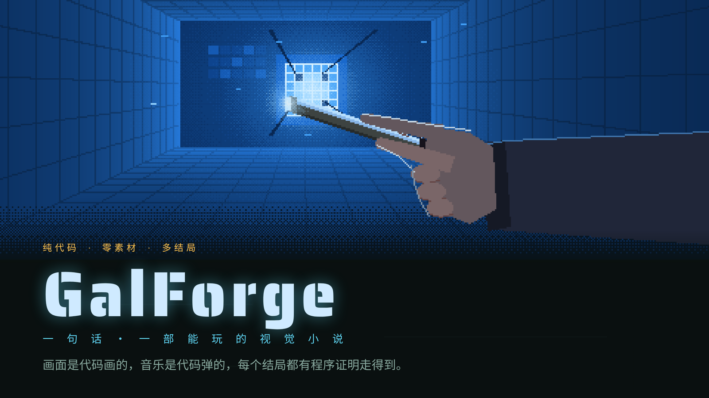
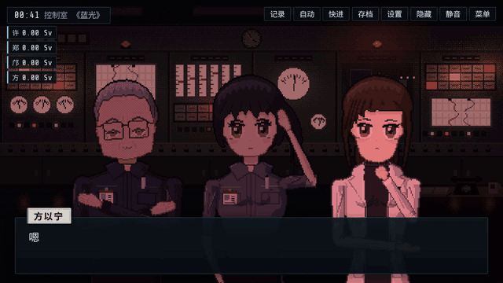
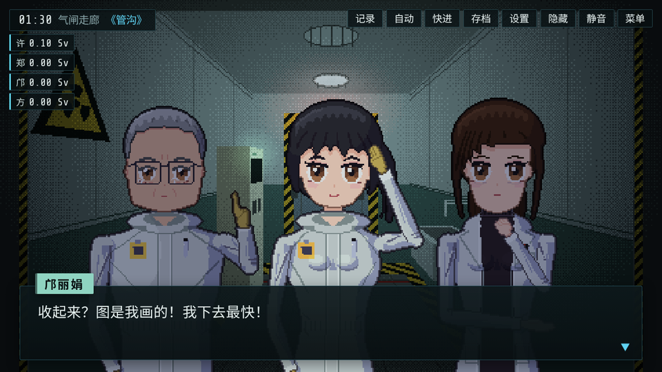
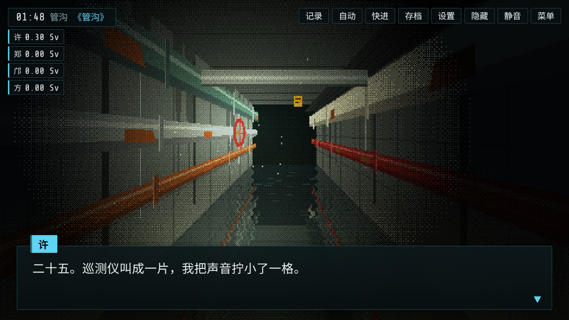
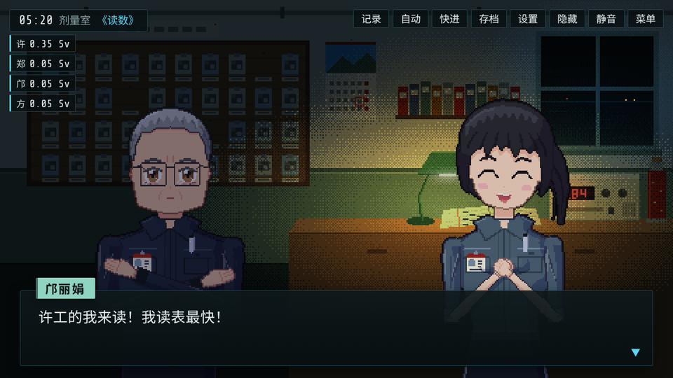
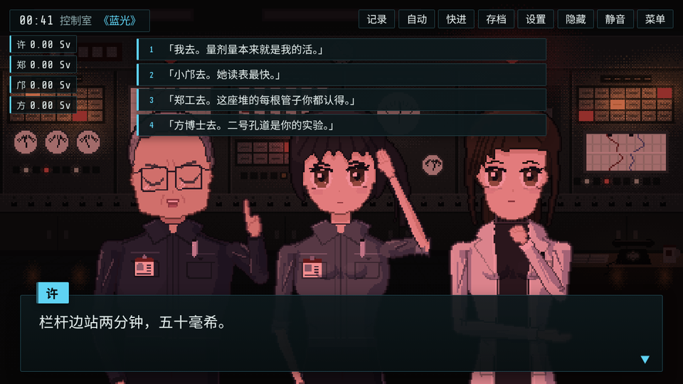
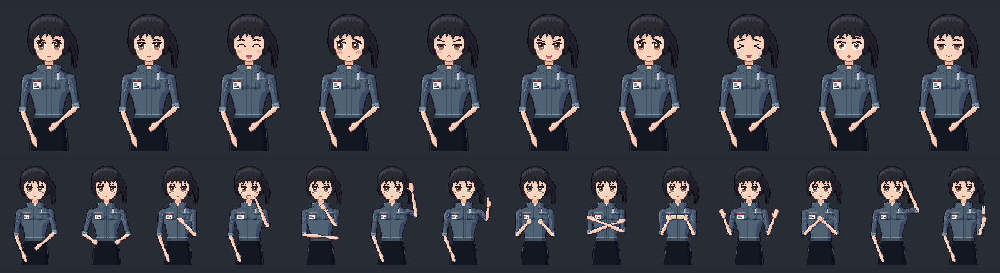

<p align="center">
  
</p>

<p align="center">
  <b>One sentence in, a playable pixel-art visual novel out.</b><br>
  Every sprite, scene and note of music is written as code: no image assets, no image-generation models.
</p>

<p align="center">
  <a href="https://lyra-planet.github.io/galforge/"></a>
  <a href="LICENSE"></a>
  <a href="https://agentskills.io/"></a>
  <a href="#install"></a>
  <a href="#install"></a>
  <a href="#install"></a>
  <a href="#install"></a>
  <a href="#install"></a>
  <a href="#install"></a>
</p>

<p align="center">
  <a href="https://lyra-planet.github.io/galforge/"><b>Play the demo</b></a> · <a href="README.md">中文</a> · English
</p>

GalForge is an [Agent Skill](https://agentskills.io/). Give your coding agent a one-line idea and it designs, writes, draws, scores, tests and ships a complete branching visual novel that runs in any browser.

## What one sentence produced

The whole prompt was 「写一个辐射主题的」 ("write one about radiation"). The agent came back with *Dose Margin* (《余量》): one night at a seaside research reactor in the 1990s. You are the dosimetrist on night shift. Every job inside the high-dose zone needs someone to go in, and whoever goes spends their own remaining dose. Before dawn you have to write everyone's number into the logbook.

<p align="center">
  <a href="https://lyra-planet.github.io/galforge/"></a>
</p>

<p align="center"><b>4 chapters · 6 endings · 25 choice points · 1,064 lines · 3 CGs · 5 music tracks · 40–50 min</b></p>

<p align="center">
  
  
  
  
</p>

The whole game (engine, art, music and script) is 454 KB, smaller than the GIF above.

## Every pixel is code

<p align="center">
  
</p>

One character, 10 expressions, 14 poses. Hair, face, clothes and hands are parameters, so the same person looks the same in every shot, and changing an outfit is a one-line edit. Characters blink, breathe and move their mouths while talking. Lighting, weather, screen shake and transitions are computed by the engine; music and ambience are synthesized live with WebAudio.

## Every ending is proven reachable

The skill ships ten tools that a game must pass before delivery: a script validator, an exhaustive ending solver (for *Dose Margin*: all 6 endings reachable, 2.62 million states searched, no dead ends), an engine playtester that replays the shortest route to every ending, a real-browser playthrough with a touch-target audit, a sprite renderer, and more. Each chapter is also read by an independent reviewer agent; for *Dose Margin* they caught 23 serious and 71 minor issues, all fixed.

## Not the same game twice

Language models pick the most likely option at every step, so AI-written stories drift toward the same tropes. GalForge gives no plot or character examples, generates six candidate concepts from six different starting points, checks drafts against a cliché list, and keeps a fingerprint of every game you have made so the next one steers away from them.

## Install

```bash
npx skills add lyra-planet/galforge
```

Or clone it into your agent's skill directory:

```bash
# Claude Code
git clone https://github.com/lyra-planet/galforge ~/.claude/skills/galforge

# Codex, Cursor, Gemini CLI, OpenCode, GitHub Copilot and others
git clone https://github.com/lyra-planet/galforge ~/.agents/skills/galforge
```

Requires Node 18+. Real-browser tests need Python Playwright. Voice acting is optional and works with any command-line TTS.

Then just ask: "make a galgame", "a mystery visual novel with three endings", or "write one about radiation".

## License

MIT. The engine files carry a one-line license header, so games built with GalForge stay compliant without extra steps.

## Self-test

```bash
bash selftest/run.sh   # 98 seeded-bug assertions
```
